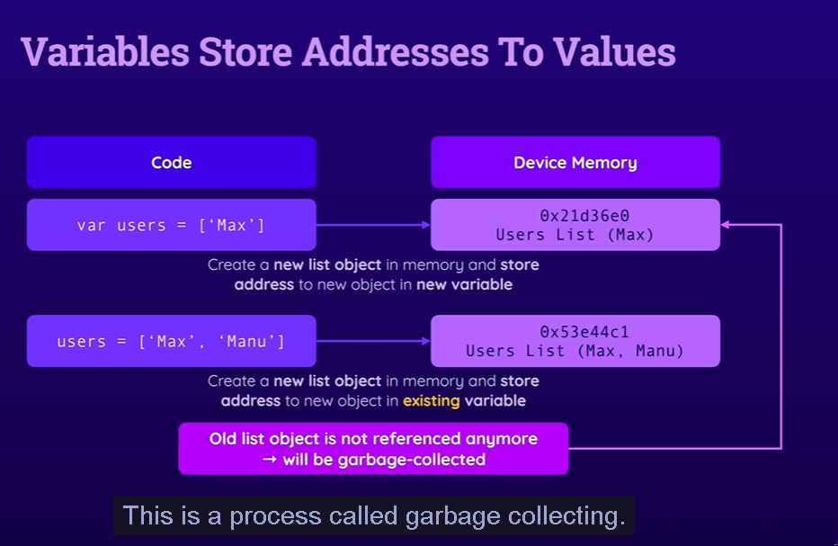
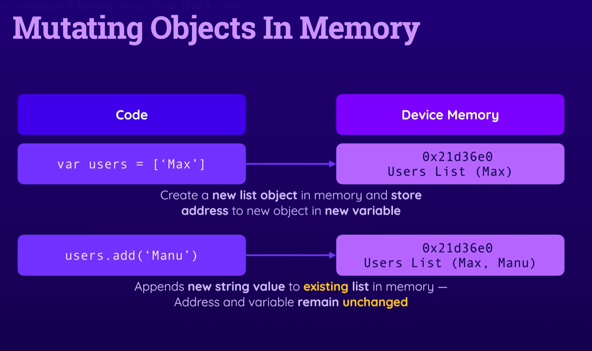
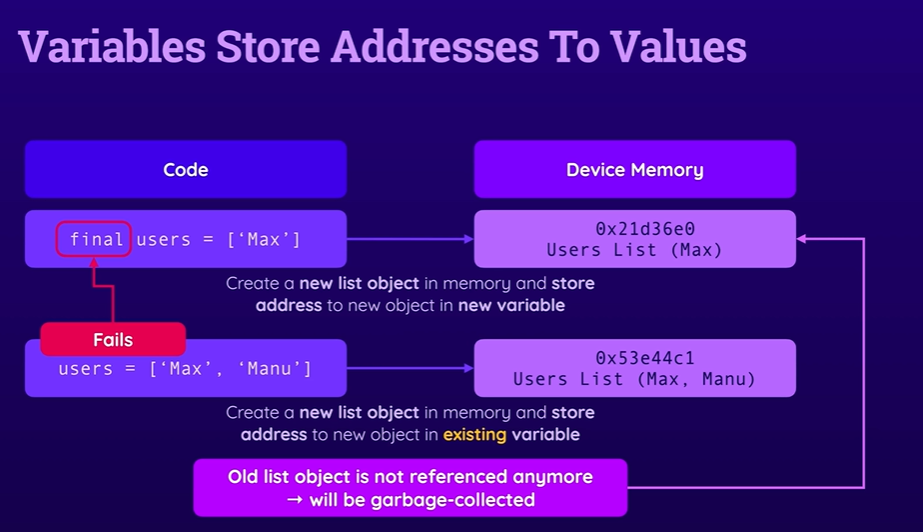
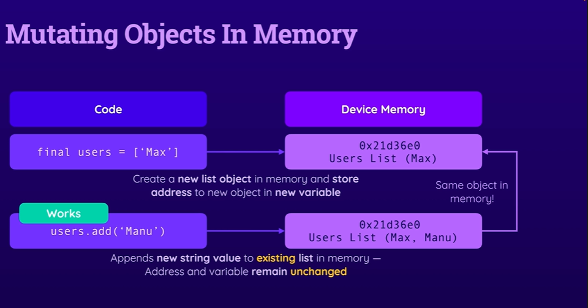
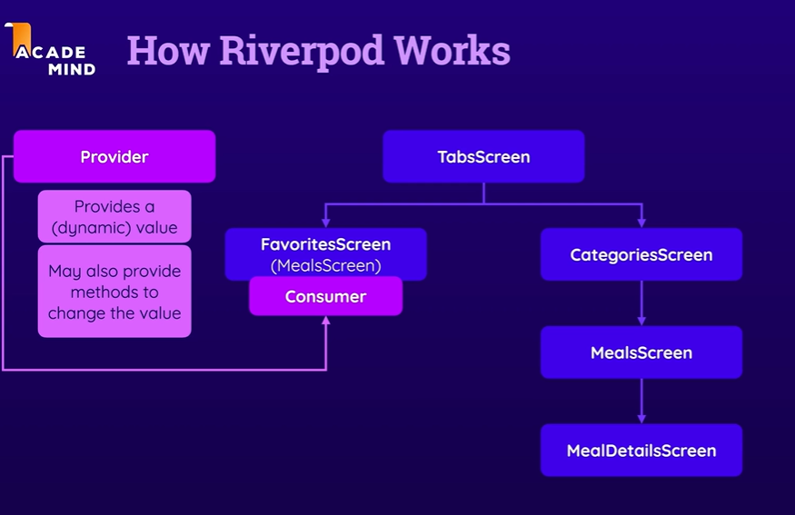
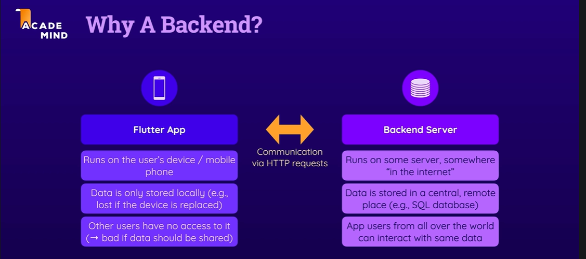
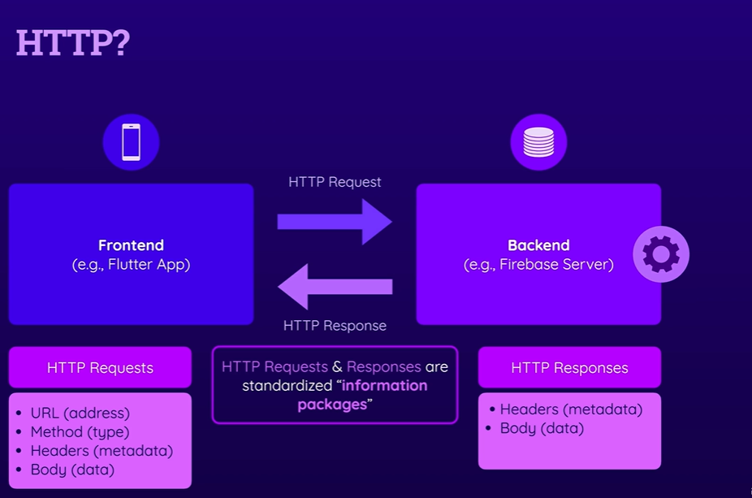

Flutter & Code Formatting
Dart comes with a code formatter which - for example when using VS Code - will cause your code to be auto-formatted to be more readable.

Since Dart 3.7.0 the code formatter has changed slightly (compared to what you see in the course videos).

→ The code formatter will now remove the final comma and put code onto one line, if it fits the configured line width. This is not a significant change and does NOT affect how the code execute.

Important: You can change this (back to what you see in the videos)!

To do that, edit (if they file already exists) or add a new file analysis_options.yaml in your Flutter project.

On the outermost indentation level, add the following configuration:

```yaml
# This file configures the analyzer, which statically analyzes Dart code to
# check for errors, warnings, and lints.
#
# The issues identified by the analyzer are surfaced in the UI of Dart-enabled
# IDEs (https://dart.dev/tools#ides-and-editors). The analyzer can also be
# invoked from the command line by running `flutter analyze`.

# The following line activates a set of recommended lints for Flutter apps,
# packages, and plugins designed to encourage good coding practices.
include: package:flutter_lints/flutter.yaml

formatter:
  trailing_commas: preserve

linter:
  # The lint rules applied to this project can be customized in the
  # section below to disable rules from the `package:flutter_lints/flutter.yaml`
  # included above or to enable additional rules. A list of all available lints
  # and their documentation is published at https://dart.dev/lints.
  #
  # Instead of disabling a lint rule for the entire project in the
  # section below, it can also be suppressed for a single line of code
  # or a specific dart file by using the `// ignore: name_of_lint` and
  # `// ignore_for_file: name_of_lint` syntax on the line or in the file
  # producing the lint.
  rules:
    # avoid_print: false  # Uncomment to disable the `avoid_print` rule
    # prefer_single_quotes: true  # Uncomment to enable the `prefer_single_quotes` rule

# Additional information about this file can be found at
# https://dart.dev/guides/language/analysis-options
```

## Creating custom widget

1. if you dont have any internal data that changes the UI extend StatelessWidget

2. if you internal data that changes the UI extend StatefulWidget and create a private class with same name as the widget class appended by the name State i.e (YourWidgetNameState) but with an underscore (\_) in front of it and extend State<YourWidgetNameState>.

## Lifting the stateup

- one common widget renders multiple screens based on conditinal widget rendered. In this case, the state of the widget is lifted up to the parent widget and passed down to the child widgets as a parameter.

## StatefulWidget LifeCycle

Deep Dive: Flutter's (Stateful) Widget Lifecycle
Every Flutter Widget has a built-in lifecycle: A collection of methods that are automatically executed by Flutter (at certain points of time).

There are three extremely important (stateful) widget lifecycle methods you should be aware of:

initState(): Executed by Flutter when the StatefulWidget's State object is initialized

build(): Executed by Flutter when the Widget is built for the first time AND after setState() was called

dispose(): Executed by Flutter right before the Widget will be deleted (e.g., because it was displayed conditionally)

## if in lists

Using "if" Statements In Lists
The if statement is a crucial feature of the Dart language - actually, it's a core feature of pretty much all programming languages.

In addition to what you learned in the previous lecture, in Dart, you may also use if inside of lists to conditionally add items to lists:

final myList = [
1,
2,
if (condition)
3
];
In this example, the number 3 will only be added to myList if condition was met (condition can be true or false or a check that yields true or false - e.g., day == 'Sunday').

Please note that there are NO curly braces around the if statement body. The if statement body also only comprises the next line of code (i.e., you can't have multiple lines of code inside the if statement).

You can also specify an else case - an alternative value that may be inserted into the list if condition is not met:

final myList = [
1,
2,
if (condition)
3
else
4
];
Using this feature is optional. Alternatively, you could, for example, also work with a ternary expression:

final myList = [
1,
2,
condition ? 3 : 4
];
Especially when inserting more complex values (e.g., a widget with multiple parameters being set) into a more complex list (e.g., a list of widgets passed to a Column() or Row()), this feature can lead to more readable code.

https://github.com/dart-lang/language/blob/master/accepted/2.3/control-flow-collections/feature-specification.md

## if statements & comparison operators

if Statements & Comparison Operators
When using if statements - no matter if inside or outside of functions - as well as when using ternary expressions, you ultimately must provide a boolean value (true / false):

if (true) {
// do something ...
}

// or

true ? 'this' : 'that'

Of course, hardcoding true or false into the code makes no sense though - you wouldn't need an if statement or ternary expression if a value would always be true or always be false.

Instead, true or false is typically derived by comparing values - e.g, comparing a number to an expected value:

if (randomNumber == 5) {
// do something
}

The == operator checks for value equality (i.e., the values on the left and right side of the operator must be equal). It must not be mistaken with the assignment operator (which uses a single equal sign: =).

The assignment operator is used to assign values to variables:

var userName = 'Max'; // assignment operator used
if (userName == 'Max') { ... } // comparison operator used

Besides the equality operator (==) Dart also supports many other key comparison operators:

!= to check for inequality (randomNumber != 5 expects randomNumber to NOT be 5, i.e., to be any other value)

> to check for the value on the left to be greater than the value on the right (randomNumber > 5 yields true if randomNumber is greater than 5)

> = to check for the value on the left to be greater than or equal to the value on the right (randomNumber >= 5 yields true if randomNumber is greater than 5 or equals 5)

< to check for the value on the left to be smaller than the value on the right (randomNumber < 5 yields true if randomNumber is smaller than 5)

<= to check for the value on the left to be smaller than or equal to the value on the right (randomNumber <= 5 yields true if randomNumber is smaller than 5 or equals 5)

## installing thrid party package

- for most of the things we use thrid party code published via packages available in pub.dev
- Example using google_fonts package from pub.dev to usegooglefonts in flutter app

- flutter pub add <packagename> (to add a third party )
- then import it and start using it as per its manuel or documentation

## Using for loops in lists

Using "for" Loops In Lists
Just as you can also use the if keyword inside of lists (to add elements conditionally), you can also use the for keyword to add multiple items into a list:

final numbers = [5, 6];
final myList = [
1,
2,
for (final num in numbers)
num
];
In this example, the numbers 5 and 6 will be added to myList (hence myList thereafter is [1, 2, 5, 6]).

This for ... in syntax is a special variation of the for loop that loops through multiple items in a list. You will see it again later in the course - both outside and inside of a list. It will also be explained again later.

The idea behind this loop is to simplify the process of performing some operation on all items in a list.

When used in a list, it's essentially an alternative to the spread operator (...):

final numbers = [5, 6];
final myList = [
1,
2,
...numbers
];
It can be useful in scenarios where values must be transformed before being added to a list - the for ... in loop can then be used instead of map() + spread operator:

final numbers = [5, 6];
final myList = [
1,
2,
...numbers.map((n) {
return n * 2;
}) // adds 10 and 12
];
can be replaced with:

final numbers = [5, 6];
final myList = [
1,
2,
for (final num in numbers)
num * 2 // adds 10 and 12
];
As mentioned, you will learn more about for later in the course.

You can also learn more about for ... in inside of lists here: https://github.com/dart-lang/language/blob/master/accepted/2.3/control-flow-collections/feature-specification.md#repetition

## Running app on real device

https://docs.flutter.dev/platform-integration/android/setup#set-up-devices

## debugging flutter apps

1. Run tab in vscode Run without debugging see debu console and resolve based on stack trace

2. Run tab vscode Run start debugging add breakpoints and debug (this slows your app use only while trying to fix bug)

3. flutter devtools vscode command palete (Ctrl + shit + p) -> flutter devtools -> open devtools in web browser -> use ZFlutter lyaourt and debugger more helpful

1 is generally enough to run flutter in development mode

## SnackBar (Like toast messages in websites )

One important change with the latest version of Flutter - to have it disappear automatically, add `persist: false` to the SnackBar widget

## Flutter and Material3 Design

Flutter & Material 3
If you're working with a recent version of Flutter, it will automatically use the "Material 3" look and settings.

I recorded this course with Material 3 BUT at the time where I did record it, this mode had to be enabled manually by setting useMaterial3 to true when working with themes.

You'll see that in the next lectures.

Since Material 3 is the default now, useMaterial3 no longer needs to be set to true, hence you can and should skip that setting. The rest of the code shown in the lectures remains unchanged though.

## dark mode

Important: Adding Dark Mode
In the next lecture, we'll add "Dark Mode" to the app.

The code you'll see in the next lecture works as shown, with one important exception (that you should adjust in your code):

The useMaterial3: true flag is no longer needed if you're using the latest version of Flutter - because Material 3 is already the default with that.

In addition, instead of adding a dark theme like this:

ThemeData.dark(
useMaterial3: true,
colorScheme: kColorScheme,
cardTheme: ...
)
you should add it like this (in the next lecture, when we write that code):

ThemeData.dark().copyWith( // dark() no longer takes any arguments
useMaterial3: true,
colorScheme: kColorScheme,
cardTheme: ...
)
That's all!









## Cross-widget state management

Riverpod instead of old providers packeg or the normal lifting the state up to the parent widget and passing it down to the child widgets as a parameter.( same issue as prop drilling in react)

Riverpod Versions
This course was recorded based on Riverpod versions <3.

If you're working with more recent versions in your project, you will need to import certain classes like StateProvider from the legacy.dart file like this:

import 'package:flutter_riverpod/legacy.dart';



Older versions of this course used the "provider" package instead of "riverpod" for app-wide state management.

riverpod is a library created by the same developer as the provider library - it's essentially a re-write of the provider package, fixing many of the flaws of that library (also see: https://github.com/rrousselGit/riverpod).

That's why this course uses riverpod.

As mentioned in the section, there generally are many other alternative packages you could use instead - for example Redux or Bloc. This page from the official documentation gives you a good overview of available packages - definitely feel free to play around with them and find the package your personally like most.

https://docs.flutter.dev/data-and-backend/state-mgmt/simple

https://pub.dev/packages?q=topic%3Astate-management

https://docs.flutter.dev/data-and-backend/state-mgmt/options

## Connecting to backend and interacting with backend via flutter apps





The difference between using await and not using it comes down to what your code does next:

With await: Your code pauses execution inside that specific function until the network response comes back, keeping everything else free to run in the meantime.

Without await (Fire-and-Forget): Your code keeps racing forward immediately on the next line, while the delete request happens completely independently in the background.

As long as you're okay with not knowing the exact moment it finishes (and have a .catchError() just in case it fails), it won't freeze your app at all.

##

shared_preference package or sqlite (to store data on the users device)

path_provider to deal with files and directories on the users device

image-picker (for camera access) or location (to get user location ) or GoogleMaps to integrate js google map api and show map via google console api

## Using native device features

Adding Your Own Native Code
With Flutter, when using native device features, you'll very likely use external packages most of the time - like the ImagePicker (for camera) or location (to get user location ) or GoogleMaps packages used in this section.

But if you need to tap into a certain native device functionality that's not exposed by any package, you can also write your own native code and connect that to your Flutter code.

It's a rarely needed feature but this page from the official documentation explains how you could add your own native code: https://docs.flutter.dev/development/platform-integration/platform-channels

## Publishing ios and Android Apps

Publishing iOS & Android Apps
Ultimately, after building and thoroughly testing your Flutter app, you might want to publish it to Google's Play Store or Apple's AppStore.

Publishing to these stores is actually not really difficult but involves a couple of steps. Hence it's best to go through the official, written, step-by-step instructions for the different platforms:

Publish an Android App: https://docs.flutter.dev/deployment/android

Publish an iOS App: https://docs.flutter.dev/deployment/ios

In those guides, you don't just learn how to publish your apps but also how to configure their icons, titles & more useful settings.

## official docs for further learning

https://docs.flutter.dev/ui/widgets

https://docs.flutter.dev
